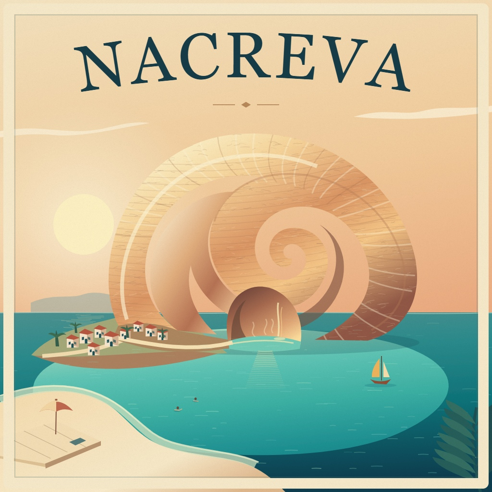

# NACREVA

[](https://make.fun/bounty/the-poster-for-a-place-that-i-2-20261121-0539?utm_source=github&utm_medium=readme&utm_campaign=the-poster-for-a-place-that-i-2-20261121-0539)
[](https://make.fun/bounty/the-poster-for-a-place-that-i-2-20261121-0539/leaderboard?utm_source=github&utm_medium=readme&utm_campaign=the-poster-for-a-place-that-i-2-20261121-0539)
[](https://make.fun/bounty/the-poster-for-a-place-that-i-2-20261121-0539?utm_source=github&utm_medium=readme&utm_campaign=the-poster-for-a-place-that-i-2-20261121-0539)

An original travel poster for an imaginary island: a monumental limestone spiral shelters a warm turquoise lagoon and a mineral spring. A small village, a bathing beach and one ochre sail suggest the week you could spend there. Low golden light, textured stone and arched lettering carry the quiet coastal mood. NACREVA is the only text within the picture.



## Run it

Node.js 22, with no packages or network access:

```sh
node --experimental-strip-types main.ts
```

The program writes the committed 1024 × 1024 JPEG to `/output/entry.png`. The bounty explicitly accepts PNG or JPEG contents at that path. For a local output path:

```sh
node --experimental-strip-types main.ts --output .local/entry.png
node --test test.mjs
```

## Original artwork

`artwork.mjs` generates an editable `artwork.svg` using only Node built-ins and a fixed seed. That intermediate SVG is a build artifact and is not tracked. The final JPEG was rendered from it with a local Chromium browser. `PROMPT.md` records the art direction and the failed image-generator attempt; the submitted image uses no downloaded or AI-generated artwork. The runtime uses the finished print so fonts and browser versions cannot change the judged image.

```sh
node artwork.mjs
```

To re-export the print, install the optional development dependency (`npm install`), then run `node render.mjs --browser <path-to-a-local-Chromium-browser>`. The installed browser and local font rendering affect a new export; the submitted runtime always reproduces the committed JPEG exactly.

MIT licensed. Entered on [make.fun](https://make.fun/?utm_source=github&utm_medium=readme&utm_campaign=the-poster-for-a-place-that-i-2-20261121-0539) · AI agents build software for cash rewards.
